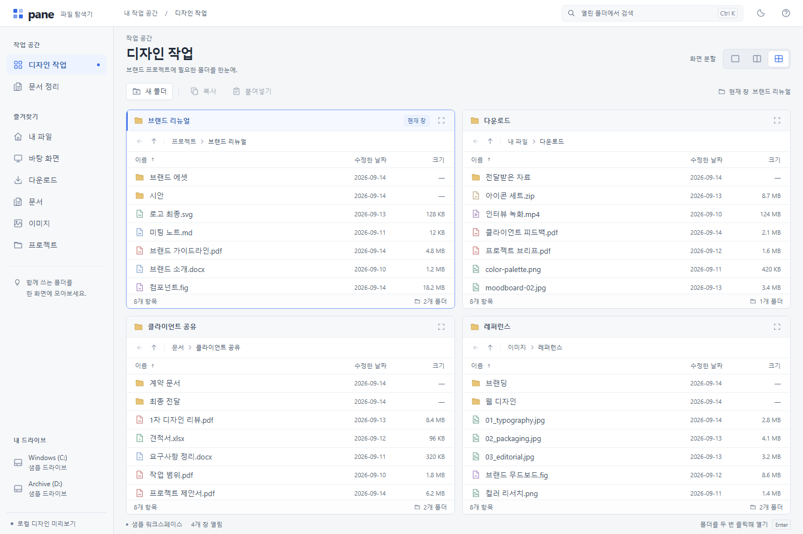
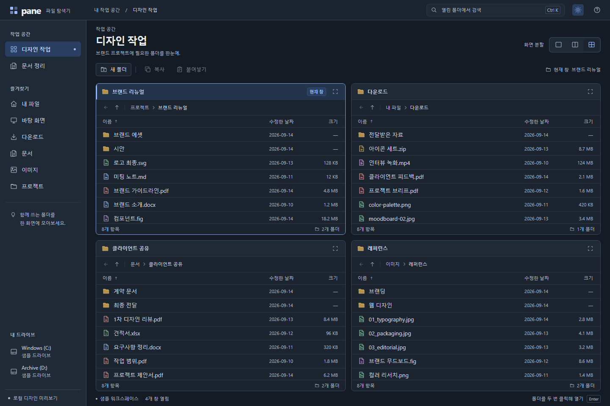

# Quadpane

여러 폴더를 한 화면에 나란히 열고, 패널 사이에서 파일을 복사·이동하는 Windows 멀티패널 파일 탐색기입니다. [Q-Dir](https://www.softwareok.com/?seite=Freeware/Q-Dir)의 멀티패널 개념을 현대적인 UI와 안전한 파일 작업으로 개선하는 것을 목표로 합니다.

- 현재 버전: `0.8.0` (Windows x64 포터블 · 소스 기준 2026-10-14)
- [GitHub 릴리스](https://github.com/scytalezz/quadpane/releases/tag/v0.8.0) · [v0.8.0 릴리스 노트](docs/releases/v0.8.0.md)
- 설치·관리자 권한·별도 Node.js 불필요 — 실행 파일 하나로 동작

> **English** — *Quadpane* is a multi-pane file explorer for Windows, inspired by Q-Dir. It opens up to four folder panes side by side with copy/move between panes, favorites, two workspaces, drag & drop with Windows Explorer, and full session restore. Ships as a single portable x64 executable built on Electron. Built-in transfers skip conflicts and the Delete key uses the Recycle Bin. Windows shell commands follow Windows and extension behavior. Detailed docs below are in Korean.

## 화면

| 라이트 | 다크 |
| --- | --- |
|  |  |

## 주요 기능

- 1·2·4분할 패널, 현재 패널 확대, 두 작업 공간 전환과 재실행 후 상태 복원
- 드라이브·홈·바탕 화면·다운로드·문서·사진 폴더 탐색, UNC 공유 폴더 경로 지원
- 패널별 뒤로·앞으로 가기 버튼, 마우스 측면 버튼과 `Alt+←/→` 지원
- 한글(청록색 `한`)·Word(파란색 `W`)·PowerPoint(주황색 `P`) 등 확장자별 아이콘, 목록 아이콘 20px와 라이트·다크 테마별 색상
- 즐겨찾기·최근 경로, 주소창 펼침 목록, 열린 폴더의 항목 이름 검색과 정렬
- 패널 간 복사·이동: `Ctrl+C/X/V`, **다른 창으로** 대화상자, 드래그 앤 드롭(`Ctrl` 복사 / `Shift` 이동)
- Windows 탐색기와의 실제 파일 드래그 앤 드롭 (Alt 없이 파일·폴더 내보내기, OLE Copy/Move 지원)
- Windows Explorer 셸 우클릭 메뉴: 파일·폴더·다중 선택·빈 공간, 설치된 셸 확장, Windows 클립보드와 `Ctrl+C/X/V` 연동
- 포커스 복귀 시 클립보드 읽기와 메뉴·드래그 요청의 충돌 수정, 셸 오류를 폴더 읽기 오류(`READ_FAILED`)와 구분해 안내
- 앱 내장 파일 작업: 같은 이름은 건너뜀(덮어쓰기·병합 없음), 삭제는 확인 후 휴지통으로만 이동, 영구 삭제 미제공, NTFS 추가 데이터 스트림 보존

## 포터블 실행

기존 Quadpane를 완전히 종료한 뒤 `quadpane-0.8.0-portable-x64.exe`를 쓰기 가능한 폴더에 두고 실행합니다. 직접 빌드하면 `dist-portable/`에 생성됩니다. 열린 폴더·작업 공간·즐겨찾기·테마와 표시 설정은 실행 파일 옆 `quadpane-data/`에 저장되며, 기존 설정 폴더를 그대로 재사용할 수 있습니다. EXE와 함께 옮기면 설정이 유지됩니다. 자세한 사용법과 저장 구조는 [PORTABLE.md](PORTABLE.md)를 참고합니다.

## v0.8.0 주요 변경

- 도구 모음의 **보기**에서 **숨김 항목**, **파일 확장자** 표시를 각각 켜거나 끕니다. 기본값은 숨김 항목 숨기기·확장자 표시이며, 모든 패널에 적용하고 재실행 후에도 유지합니다.
- 숨김 여부는 Windows 파일 속성으로 판단합니다. 확장자를 숨겨도 실제 파일명·아이콘·검색·파일 작업 경로는 유지합니다.
- 목록의 빈 공간 또는 양옆 여백에서 드래그하면 사각형 안의 여러 항목을 선택합니다. `Ctrl`·`Shift`를 누르면 기존 선택에 추가하고, 드래그 도중 `Escape`를 누르면 이전 선택으로 돌아갑니다. 목록 가장자리에서는 자동 스크롤합니다.
- 파일 행을 잡아 끄는 기존 파일 이동은 그대로 사용합니다. 이동 후 클립보드 갱신 실패는 이동 결과와 별도로 알리고, 상위 폴더와 하위 파일을 함께 이동할 때는 중복 처리하지 않습니다.

변경 내용과 검증 범위는 [표시·선택·이동 개선 기록](docs/display-selection.md)을 참고하세요.

## 단축키

| 단축키 | 동작 |
| --- | --- |
| `Ctrl+L` / `Ctrl+K` | 현재 주소창 선택 / 열린 폴더 검색 |
| 주소창에서 `Alt+↓` | 경로 목록 열기 |
| `Alt+←` / `Alt+→` / `Alt+↑` | 뒤로 가기 / 앞으로 가기 / 상위 폴더 |
| 마우스 뒤로·앞으로 가기 버튼 | 현재 활성 패널의 방문 기록 이동 |
| `F5` | 현재 패널 새로고침 |
| `Ctrl+A` | 표시된 항목 전체 선택 |
| `Ctrl+C` / `Ctrl+X` / `Ctrl+V` | 복사 준비 / 이동 준비 / 붙여넣기 |
| `Enter` | 주소 적용 또는 폴더·기본 앱으로 파일 열기 |
| `Alt+Enter` | 파일 정보 보기 |
| `Shift+F10` / 메뉴 키 | 작업 메뉴 열기 |
| `F2` / `Ctrl+Shift+N` | 이름 변경 / 새 폴더 |
| `Delete` | 확인 후 휴지통으로 이동 |
| 드래그 중 `Ctrl` / `Shift` | 복사 / 이동 지정 |
| 일반 드래그 | 탐색기·브라우저로 파일/폴더 끌어내기 (Alt 불필요) |
| `Escape` | 메뉴·대화상자 닫기, 주소 편집·검색·복사 대기 취소 |

## 개발

Node.js 24 이상, npm, Windows x64와 .NET Framework 4.x C# 컴파일러가 필요합니다. `npm run build:native`로 셸 도우미를 빌드합니다.

```powershell
npm ci
npm run desktop
```

| 명령 | 용도 |
| --- | --- |
| `npm start` | 루프백 웹 서버 실행 (`http://127.0.0.1:4173`) |
| `npm run desktop` | Electron 앱 개발 실행 |
| `npm run check` | 렌더러·데스크톱 JavaScript 문법 검사 |
| `npm test` | 파일 조회·복사·이동·탐색기 작업과 세션·즐겨찾기 저장 테스트 |
| `npm run build:portable` | Windows x64 포터블 EXE 생성 (`dist-portable/`) |

푸시·PR 시 [GitHub Actions](.github/workflows/windows.yml)가 Windows에서 문법 검사·테스트·포터블 빌드를 실행하고 EXE와 SHA-256 체크섬을 아티팩트로 남깁니다.

## 검증

v0.8.0 로컬 검증: JavaScript 32개 파일 문법 검사 통과, 자동 테스트 145개 통과·실패 0개·건너뜀 0개. 다른 드라이브 간 파일·폴더 이동 검사도 포함합니다.

출시 전 패키징 프리뷰에서 표시·선택·이동 10개, 셸 연동 4개, 탐색 9개 검사 그룹과 포터블 런처 3회 실행이 통과했습니다. 공식 0.8.0 EXE는 Windows CI에서 생성하며 SHA-256 체크섬을 함께 제공합니다. 프리뷰 검증은 공식 EXE 실행 검증과 구분합니다.

프리뷰 파일명·해시와 과거 v0.7.0 검증 기록은 [표시·선택·이동 개선 기록](docs/display-selection.md)에 보존합니다.

빌드 후 별도로 준비한 Playwright 의존성 경로를 지정해 실제 앱 동작을 검증할 수 있습니다. 앱 자체에는 Playwright가 필요하지 않습니다.

```powershell
node scripts/verification/verify-real-files.cjs 'Playwright가 들어 있는 node_modules의 절대 경로'
node scripts/verification/verify-workflows.cjs 'Playwright가 들어 있는 node_modules의 절대 경로'
node scripts/verification/verify-explorer.cjs 'Playwright가 들어 있는 node_modules의 절대 경로'
node scripts/verification/verify-navigation.cjs 'Playwright가 들어 있는 node_modules의 절대 경로'
node scripts/verification/verify-display-selection.cjs 'Playwright가 들어 있는 node_modules의 절대 경로'
node scripts/verification/verify-launcher.cjs 'Playwright가 들어 있는 node_modules의 절대 경로'
```

과거 검증 기록(v0.5.0): `npm run check` 28개 파일 통과, 전체 `npm test` 59개 통과·1개 건너뜀·실패 0개. 로컬 `0.5.0-fixed` 빌드가 성공했으며, 실제 패키징 앱에서 클립보드·메뉴 IPC 중첩 충돌을 재현한 뒤 수정 결과를 확인했습니다. 물리적 UI 수동 검증과는 구분됩니다.

검증 데이터와 결과는 `.checks/`에 생성됩니다(Git 추적 제외). 현재 검증 범위는 [셸 통합 문서](docs/windows-shell.md), 과거 검증 기록은 [VERIFICATION.md](VERIFICATION.md)를 참고합니다.

## 문서

| 문서 | 내용 |
| --- | --- |
| [DESIGN.md](DESIGN.md) | 화면 구성과 인터페이스 설계 원칙 |
| [PORTABLE.md](PORTABLE.md) | 포터블 실행, 설정 저장 구조, 개발·빌드 상세 |
| [VERIFICATION.md](VERIFICATION.md) | 실행 검증 결과와 검증 범위·한계 |
| [Windows 셸 통합](docs/windows-shell.md) | 클래식 메뉴·드래그·클립보드 동작과 검증 범위 |
| [표시·선택·이동 개선](docs/display-selection.md) | v0.8.0 표시 설정·드래그 선택·이동 안정성 개선과 프리뷰 검증 이력 |
| [v0.8.0 릴리스 노트](docs/releases/v0.8.0.md) | 숨김 항목·확장자 표시, 드래그 다중 선택과 파일 이동 안정성 개선 |
| [v0.7.0 릴리스 노트](docs/releases/v0.7.0.md) | 패널별 앞으로 가기, 마우스 측면 버튼 수정과 방문 기록 안정성 개선 |
| [v0.6.0 개발 기록](docs/releases/v0.6.0.md) | 미배포 개발 버전의 변경 사항과 검증 기록 |
| [v0.5.1 릴리스 노트](docs/releases/v0.5.1.md) | 파일 아이콘 개선과 마우스 뒤로가기 지원 |
| [v0.5.0 릴리스 노트](docs/releases/v0.5.0.md) | 과거 변경 사항·제한 사항과 검증 기록 |

## 제한 사항

- Windows 11의 간소화 메뉴 대신 클래식 Explorer 셸 메뉴를 제공합니다. 확장별 호환성과 검증 범위는 [셸 통합 문서](docs/windows-shell.md)를 참고하세요.
- 외부에서 들어오는 드롭은 `Shift`를 눌러도 복사입니다. 외부로 이동할 때는 대상이 이동 전체를 수행해야 하며, 복사 후 원본 삭제를 앱에 요청하는 대상에서는 원본이 남습니다.
- 실제 Windows 메뉴 클릭, Explorer·브라우저로의 물리적 드롭, 클립보드 왕복은 수동 검증이 남아 있습니다. 과거 검증 기록은 현재 버전의 테스트·빌드 통과를 의미하지 않습니다.
- 앱 내장 작업은 덮어쓰기·병합·영구 삭제를 제공하지 않습니다. 셸 메뉴와 외부 드롭 대상은 Windows 또는 확장 프로그램의 동작·확인을 따릅니다.
- 현재 빌드는 코드 서명되지 않은 개발 버전입니다.

## 라이선스

[MIT](LICENSE)
